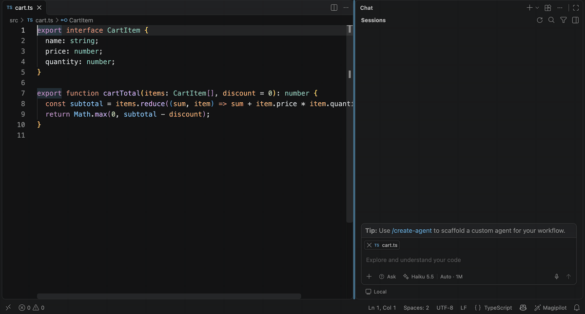
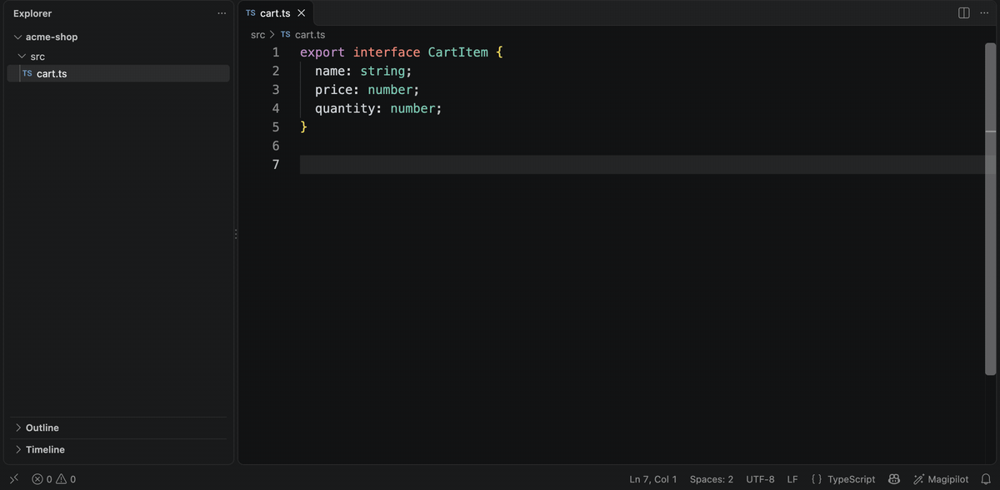
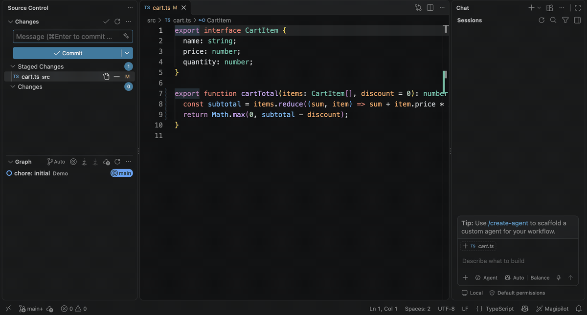

<p align="center">
  
</p>

<h1 align="center">Magipilot</h1>

<p align="center">
  <b>Ghost-text completions from a model on your machine,<br>and your Claude Code and Codex subscriptions as chat models in Copilot Chat.</b>
</p>

<p align="center">
  <a href="https://github.com/celalakcelikk/magipilot/actions/workflows/ci.yml"></a>
  <a href="https://github.com/celalakcelikk/magipilot/releases"></a>
  <a href="LICENSE"></a>
  
  
  <a href="https://github.com/celalakcelikk/magipilot/stargazers"></a>
</p>

<p align="center">
  <a href="#quick-start">Quick start</a> ·
  <a href="#features">Features</a> ·
  <a href="#installation">Installation</a> ·
  <a href="#settings">Settings</a> ·
  <a href="#privacy-and-security">Privacy</a> ·
  <a href="#faq">FAQ</a>
</p>



**Magipilot** is a small VS Code extension that fills two gaps:

1. **Inline completions** (ghost text) as you type, from a local fill-in-the-middle model (Ollama, llama.cpp, LM Studio) or from the Claude Code and Codex CLIs. No GitHub account needed.
2. **Chat models for Copilot Chat.** Your Claude Code and Codex CLI subscriptions appear in Copilot Chat's model picker as **Claude (CLI)** and **Codex (CLI)**. Use them in Ask mode and for commit messages, and, if you opt in, in agent mode and inline chat. Magipilot has no chat UI of its own: it works inside Copilot Chat.

> **Preview.** Magipilot 0.2 is tested on macOS and Linux (Ubuntu 24.04) with VS Code 1.144. Install it from the [Visual Studio Marketplace](https://marketplace.visualstudio.com/items?itemName=celalakcelikk.magipilot) or [GitHub Releases](https://github.com/celalakcelikk/magipilot/releases); it is not on Open VSX yet.

## Features

### Ghost text from a model on your own machine

**Suggestions appear as you type, and `Tab` accepts them.** The default backend is [Ollama](https://ollama.com) with `qwen2.5-coder:1.5b`, which answered in about 0.3 s at the median on an Apple M3 Pro. llama.cpp's `llama-server`, LM Studio and the Claude Code and Codex CLIs work too. The prompt carries the code around the cursor, similar snippets from open tabs and the signatures of locally imported files, never a file on your exclude list.



### Claude Code and Codex in Copilot Chat

**The subscriptions you already pay for, in the chat you already use.** Magipilot asks the installed CLIs which models they offer, so **Opus**, **Sonnet**, **Haiku** and the Codex models show up in the model picker with nothing to configure. Answers come from the unmodified CLI, started without tools of its own in an empty temporary folder; in Ask mode, Claude's answers stream in as they are written. Effort levels and context sizes are in the model picker too.

> **Your plan's terms apply.** Magipilot runs the CLIs with the sign-in you gave them, a subscription or an API key; it never reads your credentials and does not resell usage. Anthropic says its subscription plans assume ordinary, individual use and asks developers of products built on Claude to use API keys ([Claude Code legal and compliance](https://code.claude.com/docs/en/legal-and-compliance)); OpenAI recommends API keys for automated Codex workflows ([Codex authentication](https://developers.openai.com/codex/auth)). Check your plan's terms, which can change, before you use the CLI backends. The local backends need no account.

### Commit messages from your own model

**One command routes Copilot Chat's commit messages to a Magipilot model.** Run **Magipilot: Use for Commit Messages**, pick a model, and the sparkle button in Source Control writes the message with your Claude Code or Codex subscription instead of Copilot's service.



### Agent mode and inline chat (experimental)

**Opt in to tool calling, and Claude (CLI) works in agent mode and inline chat.** Copilot Chat runs the tools with its own confirmations; the CLI still has no tools of its own, and Magipilot never runs model output. It is off by default; see [Tool calling](#tool-calling-agent-mode-and-inline-chat).

### Private by design

- **No telemetry**, and no server of its own.
- **The CLIs run without tools of their own**, in an empty temporary folder, without your CLI configuration.
- **Files on your exclude list never enter a prompt**, in completions or in chat.
- **The logs hold no prompt text.**

## Quick start

**Inline completions with Ollama**

1. Install [Ollama](https://ollama.com) and pull the default model: `ollama pull qwen2.5-coder:1.5b`.
2. Start typing in a code file. Suggestions appear as ghost text; press `Tab` to accept one.

**Claude Code or Codex in Copilot Chat**

1. Install and log in to the [Claude Code](https://docs.anthropic.com/en/docs/claude-code) CLI or the Codex CLI. Check from a terminal with `claude --version` or `codex --version`.
2. Open Copilot Chat in **Ask** mode and pick a model, for example **Sonnet 5.5**, in the model picker. Magipilot asks the installed CLIs which models they offer, so there is nothing to configure.

## Requirements

- **VS Code 1.140 or newer.** It is tested with VS Code 1.144:
  - on macOS, with Copilot Chat 0.71;
  - on Linux (Ubuntu 24.04), with Ollama and the Claude Code CLI. There, the chat models were tested through VS Code's language model API, not in the Copilot Chat window.
- **Inline completions with a local model:** [Ollama](https://ollama.com) (the default) or an OpenAI-compatible server such as llama.cpp's `llama-server` or LM Studio.
- **The CLI backends:** the [Claude Code](https://docs.anthropic.com/en/docs/claude-code) CLI and/or the Codex CLI, installed and logged in with a subscription or an API key. Magipilot only starts them; it never reads their login or token files. Your plan's terms apply; see [the note](#claude-code-and-codex-in-copilot-chat).
- **Chat models:** the Copilot Chat extension. It worked without a GitHub sign-in in our tests; see [Known issues](#known-issues).
- **Where the CLI backends are off:** on Windows and in untrusted workspaces. There, only local backends are used.
- **On Linux:**
  - The CLIs must be on the `PATH` that VS Code sees. Otherwise, set `magipilot.claude.path` and `magipilot.codex.path`.
  - The Codex CLI backend is not tested on Linux yet. Magipilot finds its models there, but no Codex request has been run on Linux.
  - The Flatpak build of VS Code is not tested. Its sandbox hides programs installed outside it.

## Installation

- **From the Visual Studio Marketplace:** search for **Magipilot** in the Extensions view, or run `code --install-extension celalakcelikk.magipilot` in a terminal.
- **From GitHub Releases:**
  1. Download `magipilot-<version>.vsix` from the [latest release](https://github.com/celalakcelikk/magipilot/releases/latest).
  2. In the Extensions view, open the `…` menu and choose **Install from VSIX…**, or run `code --install-extension magipilot-<version>.vsix` in a terminal.
- **Open VSX** (VSCodium and other editors): not yet.

To remove it, choose **Uninstall** in the Extensions view.

## Inline completions

Suggestions appear while you type. `Alt+\` asks for one, and the status bar item turns them on and off.

| Setting                                                        | Default                |                                                            |
| -------------------------------------------------------------- | ---------------------- | ---------------------------------------------------------- |
| `magipilot.inline.backend`                                     | `ollama`               | `ollama`, `openai-compat`, `claude-cli` or `codex-cli`     |
| `magipilot.inline.fallbackBackend`                             | `none`                 | used when the main backend is not available                |
| `magipilot.inline.mode`                                        | `auto`                 | `manual`: only on `Alt+\`                                  |
| `magipilot.ollama.model`                                       | `qwen2.5-coder:1.5b`   | must be pulled first: `ollama pull qwen2.5-coder:1.5b`     |
| `magipilot.claude.inlineModel` / `magipilot.codex.inlineModel` | `haiku` / `gpt-6-luna` |                                                            |
| `magipilot.inline.importSignatures`                            | `true`                 | signatures of locally imported files in the prompt (below) |

**Speed.** Measured on 20 fill-in-the-middle samples on an Apple M3 Pro:

- Ollama with `qwen2.5-coder:1.5b` answered in about 0.3 s at the median.
- The Claude Code CLI answered in about 1.6 s.

**Signatures of imported files.** For TypeScript, JavaScript and Python, the prompt also carries the declarations, without their bodies, of the files the document imports with a local path.

- **What counts as a local import:** `./util` or `../lib/x.js` in TS/JS; `from .util import add`, or a module under the workspace folder, in Python.
- **How much:** for a named import, only the imported names are kept. At most 3 files of 600 characters each.
- **Not looked at:** Go, Rust, Java, `node_modules`, `site-packages` and `tsconfig` path aliases.
- **Which backends use them:**
  - the Claude and Codex CLIs;
  - Ollama with `magipilot.ollama.fim: raw` (Qwen models);
  - the OpenAI-compatible `infill` and `qwen` modes.
- **The default Ollama mode (`fim: suffix`) and the other templates do not use them**, because those prompt formats have no place for other files. Switch a Qwen model to `fim: raw` to use them.

**Magipilot: Show Stats** shows what happened since the window started:

- per inline backend: the requests and their outcomes, the latency, the suggestions shown (from the cache too), the ones accepted, and the acceptance rate;
- per chat model: the requests by outcome and their duration.

**Magipilot: Reset Stats** starts the counts again.

## Chat models in Copilot Chat

### Setup

1. **Nothing to configure.** Magipilot asks the installed CLIs which models they offer and shows them all.
   - **Claude Code** answers through its SDK protocol (the `initialize` request).
   - **Codex** answers with its model catalog (`codex debug models`); only the models Codex itself lists are shown.

   Neither question is a model call, so it costs no quota.
   - **When Magipilot asks:** when the models are first needed, again after 10 minutes or a settings change. It keeps the last list for the next start.
   - **The names:** a model is named as the CLI names it (**Opus 5.5**, **GPT-6-Luna**). A model the CLI does not name, such as an id from a list below, is named by its id.

2. Open Copilot Chat in **Ask** mode and pick a model in the model picker.

<details>
<summary>Groups, pinning, effort levels and context sizes</summary>

**Groups and pinning.**

- **Tabs.** The model picker shows the models in two tabs, **Claude (CLI)** and **Codex (CLI)**. **Manage Models** lists them under those two providers. A tab appears only while its CLI offers models.
- **Pinning.** There are two places to pin a model:
  - in the model picker, open the model's card with the **›** at the end of its row (or by changing its effort level), then click the pin icon at the top right;
  - in **Manage Models**, use the pin icon on the model's row or its context menu.

  Pinned models are listed first in their tab, under **Pinned**. Pinning is VS Code's own feature, so its behaviour is VS Code's:
  - VS Code does not let an extension put a pin button directly on the picker's rows.
  - In an extension's tab, VS Code shows no divider between pinned and other models.
  - Ask mode and agent sessions keep their pins separately.

- **Fewer models in the picker.** To see fewer models, hide the ones you do not use in **Manage Models** (eye icon).

**Effort level and context size.**

- **The label.** The label beside a model shows its effort level and its context size, for example **Auto · 1M** or **Medium · 242K**. The model's card shows both as **Effort Level** and **Context Size**.
- **Effort levels.** Each model that reports effort levels gets an **Effort Level** choice:
  - **Claude:** Auto, then Low, Medium, High, Extra High, Max. With Auto, no `--effort` is passed and Claude Code decides.
  - **Codex:** Low, Medium, High, Extra high, Max and, for most models, Ultra. The model's own default is preselected.
- **The context size is the part of the window Magipilot can use:** what it may send, plus the room kept for the answer.
  - The model's card, the label, the picker and **Manage Models** all show this same number.
  - The rest of the CLI's window is kept for the CLI's own instructions, and the model's tooltip names the CLI's full window.
  - For example, a Claude model with a 200K window shows 194K. About 2K is kept for Claude Code's instructions and 4K for Magipilot's conversion of the chat.
- **Where the windows come from.**
  - **Claude:** Magipilot asks Claude Code for each model's window in the background, through Claude Code's `/context` view (not a model call). Windows are kept for a day; until one is known, 200K is assumed.
  - **Codex:** the window comes from its catalog. With `"magipilot.chat.codex.maxContextWindow": true` in your user settings, the Codex models get their largest catalog window instead.
- **In agent sessions** ("Copilot · Interactive"), VS Code builds the model's settings itself. There it may show the size as "Max …", and the effort levels with its own names and without Auto.
- **A large window uses a lot of quota.** Copilot Chat fills the window before it drops or summarizes older turns, and every turn sends the whole conversation again. To cap every model's window, set `"magipilot.chat.contextWindowLimit"` (for example `200000`) in your user settings.
- **A smaller context size per model.** A model's **Context Size** offers **128K** and **200K** below its full size, when they are at most 80 % of it. The full size is the default; nothing changes until you choose. With a smaller size:
  - **Older messages are left out.** Magipilot keeps the conversation within that size by leaving the oldest exchanges out. A question always leaves together with its answer, and a tool call with its result.
  - **The status bar says how many** older messages were left out.
  - **A message larger than the size is still sent**, without any older message.
  - **Copilot Chat's own instructions and tools are sent in full.**
  - **The count is in bytes**, so the real number of tokens is usually lower.
  - **Agent sessions** always use the full size.

**Models the CLI does not list.** To add one (a full model id, say), put it in a list. The lists are added to what the CLIs report:

```jsonc
"magipilot.chat.claude.models": ["claude-opus-4-1"],   // Claude Code model ids or aliases
"magipilot.chat.codex.models": ["gpt-6.1-sol"]          // Codex model ids
```

With `"magipilot.chat.discoverModels": false`, only these two lists are shown (both are empty by default).

**If a model does not appear:**

- Check that the CLI runs from a terminal (`claude --version`, `codex --version`).
- Or set `magipilot.claude.path` / `magipilot.codex.path` to the executable.
- **Magipilot: Show Log** names the reason when a CLI could not be asked.

**Privacy mode.** With `"magipilot.claude.disableNonessentialTraffic": true` (the default), Claude Code lists only Opus, Sonnet and Haiku.

**API status.** The effort choice and the context size use fields that VS Code 1.144 reads from any model provider but that are not yet part of its stable API. A VS Code that does not read them shows no effort choice and computes the context size itself.

</details>

### What to expect

- **Ask mode by default.** Without tool calling, Copilot Chat does not offer the models in agent mode, and **inline chat (`Ctrl+I`/`Cmd+I`) does not use them**. Turn on [tool calling](#tool-calling-agent-mode-and-inline-chat) for both.
- **Each request starts a new CLI process.** It has:
  - no tools of its own;
  - an empty temporary folder as its working directory;
  - none of your own CLI configuration: no `CLAUDE.md`, MCP servers, hooks, plugins or settings.

  Codex runs with a read-only sandbox and without `~/.codex/config.toml`. The CLI cannot read or change your files.

- **The whole conversation is sent again on every turn**, so long conversations use more of your quota.
- **Claude answers stream.** Codex answers arrive in one piece at the end.
- **Stopping a request** in Copilot Chat kills the CLI process. A request also stops after 10 minutes.

**How Magipilot counts.** It counts one token per UTF-8 byte of the text it sends.

- That count is never too low. Random strings use about one token per byte, so any smaller estimate could let the CLI overflow its context in the middle of an answer.
- English text uses only about a quarter to a third of the real window before Copilot Chat starts to drop older turns.

### Tool calling (agent mode and inline chat)

**Off by default.** Turn it on with `"magipilot.chat.toolCalling": true` in your **user** settings; a workspace cannot turn it on. The Claude (CLI) models then declare tool calling:

- Copilot Chat offers them in **agent mode**;
- **inline chat** (`Ctrl+I`/`Cmd+I`) can use them for its edits.

How it works:

- **No tools in the CLI.** The CLI still runs without tools of its own. Copilot Chat's tool list goes into the prompt, and the CLI answers with structured output: some text, a list of tool calls, or both.
- **Copilot Chat runs the tools, with its own confirmations:** reading files, editing them, searching, and running terminal commands.
  - Read what a confirmation shows before you accept it.
  - Magipilot itself never runs a tool or any model output.
- **More quota than Ask mode.** Each agent step is a new CLI call that carries Copilot Chat's instructions, its tool list and the whole conversation so far. Measured with Claude `haiku`: 4–8 s per step, and 1.5–3× the input tokens of an Ask turn.
- **No streaming.** Answers in tool mode arrive in one piece when the CLI finishes.

Limits:

- **Codex (CLI) models do not offer tool calling yet.**
  - With Copilot Chat's full tool list, Codex answered without calling a tool in every measured run.
  - So they stay Ask-mode models even with the setting on.
  - Claude (CLI) called the tools in every run.
- **What Magipilot refuses.** These fail with an error, and nothing is run:
  - an answer that names a tool Copilot Chat did not offer;
  - arguments that are not a JSON object;
  - an answer without a call when Copilot Chat requires one.
- **Images in tool results.** Only the text of a tool result is sent; images and other content are replaced by `[non-text part omitted]`.

### Commit messages

With default settings, Copilot Chat writes commit messages **with its own service, even when you are not signed in to GitHub. Your staged diff then leaves your machine through Copilot's service**, not through your Claude or Codex subscription.

To use a Magipilot model instead:

1. Add at least one chat model (see [Setup](#setup)).
2. Run **Magipilot: Use for Commit Messages** from the Command Palette and pick a model.

**What the command writes.**

- It writes `<vendor>/<model id>` to your **user** settings `chat.utilityModel` and `chat.utilitySmallModel`; commit messages use the small one.
- The vendor is `magipilot` for Claude models and `magipilot-codex` for Codex models.
- If a workspace or folder setting overrides either value, the command warns and names it.
- To undo, remove the two settings.

These are Copilot Chat's general utility-model settings, so other small Copilot Chat tasks may use the model as well.

### Known issues

- **Copilot Chat can take a long time to start.**
  - In a fresh VS Code profile without a GitHub sign-in, Copilot Chat was usually ready after 20–90 seconds, and sometimes much later.
  - Until then, Ask-mode requests are dropped without an error, and Copilot's commit-message command is missing.

## Commands

| Command                                  | What it does                                                                                              |
| ---------------------------------------- | --------------------------------------------------------------------------------------------------------- |
| **Magipilot: Toggle Inline Completion**  | Turns inline completions on and off (also a click on the status bar item)                                 |
| **Magipilot: Trigger Inline Completion** | Asks for a suggestion now, also in `manual` mode and during a pause after a failure (`Alt+\`)             |
| **Magipilot: Use for Commit Messages**   | Routes Copilot Chat's commit messages to a Magipilot chat model (see [Commit messages](#commit-messages)) |
| **Magipilot: Show Log**                  | Opens the Magipilot output: backend, duration, sizes and failures, never prompt content                   |
| **Magipilot: Show Stats**                | Statistics since the window started (see [Inline completions](#inline-completions))                       |
| **Magipilot: Reset Stats**               | Starts the statistics again                                                                               |

## Settings

<details>
<summary>All settings</summary>

| Setting                                       | Default                            | Meaning                                                                                                                                                       |
| --------------------------------------------- | ---------------------------------- | ------------------------------------------------------------------------------------------------------------------------------------------------------------- |
| `magipilot.inline.enabled`                    | `true`                             | Show inline completions                                                                                                                                       |
| `magipilot.inline.backend`                    | `ollama`                           | `ollama`, `openai-compat`, `claude-cli` or `codex-cli`                                                                                                        |
| `magipilot.inline.fallbackBackend`            | `none`                             | Used when the main backend is refused or not available                                                                                                        |
| `magipilot.inline.mode`                       | `auto`                             | `manual`: only on `Alt+\`                                                                                                                                     |
| `magipilot.inline.debounceMs`                 | `null`                             | Delay after typing; `null` = 250 ms for local backends, 700 ms for the CLIs (chosen by measurement)                                                           |
| `magipilot.inline.maxPrefixChars`             | `3000`                             | Characters before the cursor sent as context                                                                                                                  |
| `magipilot.inline.maxSuffixChars`             | `1000`                             | Characters after the cursor sent as context                                                                                                                   |
| `magipilot.inline.maxLines`                   | `8`                                | Longest suggestion, in lines                                                                                                                                  |
| `magipilot.inline.maxFileSizeKb`              | `1024`                             | No completion in larger files                                                                                                                                 |
| `magipilot.inline.importSignatures`           | `true`                             | Signatures of locally imported files in the prompt (see [Inline completions](#inline-completions))                                                            |
| `magipilot.exclude`                           | `[".env*", "*.pem", "secrets/**"]` | Files that never enter a prompt (see [Privacy](#privacy-and-security))                                                                                        |
| `magipilot.disabledLanguages`                 | `["plaintext", "markdown"]`        | Language IDs without inline completions                                                                                                                       |
| `magipilot.claude.path`                       | `claude`                           | Claude Code CLI executable                                                                                                                                    |
| `magipilot.claude.inlineModel`                | `haiku`                            | Claude model for inline completions                                                                                                                           |
| `magipilot.claude.effort`                     | `low`                              | Claude effort for inline completions: `low`, `medium`, `high`, `xhigh`, `max`                                                                                 |
| `magipilot.claude.warmPoolSize`               | `1`                                | Claude processes started ahead of time for inline completions; `0` = one per request                                                                          |
| `magipilot.claude.disableNonessentialTraffic` | `true`                             | Runs the Claude CLI with `CLAUDE_CODE_DISABLE_NONESSENTIAL_TRAFFIC=1`                                                                                         |
| `magipilot.codex.path`                        | `codex`                            | Codex CLI executable                                                                                                                                          |
| `magipilot.codex.inlineModel`                 | `gpt-6-luna`                       | Codex model for inline completions                                                                                                                            |
| `magipilot.codex.effort`                      | `low`                              | Codex reasoning effort (inline completions and chat); only `low` is verified                                                                                  |
| `magipilot.chat.discoverModels`               | `true`                             | Show the models the installed CLIs report (see [Setup](#setup)); off: only the two lists below                                                                |
| `magipilot.chat.claude.models`                | `[]`                               | Claude models shown in Copilot Chat as **Claude (CLI)**, added to the discovered ones                                                                         |
| `magipilot.chat.codex.models`                 | `[]`                               | Codex models shown in Copilot Chat as **Codex (CLI)**, added to the discovered ones                                                                           |
| `magipilot.chat.toolCalling`                  | `false`                            | Agent mode and inline chat for the CLI models; Copilot Chat runs the tools (see [Tool calling](#tool-calling-agent-mode-and-inline-chat)); user settings only |
| `magipilot.chat.contextWindowLimit`           | `null`                             | Caps every chat model's context window (64000 to 2000000); `null` = each model's full window. Saves time and quota; user settings only                        |
| `magipilot.chat.codex.maxContextWindow`       | `false`                            | Codex chat models use their largest catalog window (872K) instead of Codex's default; more quota; user settings only                                          |
| `magipilot.ollama.url`                        | `http://localhost:11434`           | Ollama server; user settings only, so a workspace cannot send your code to another host                                                                       |
| `magipilot.ollama.model`                      | `qwen2.5-coder:1.5b`               | Ollama model (`ollama pull` it first)                                                                                                                         |
| `magipilot.ollama.fim`                        | `suffix`                           | `suffix`: Ollama builds the prompt; `raw`: Magipilot does, with `magipilot.ollama.template` (needed for import signatures)                                    |
| `magipilot.ollama.template`                   | `qwen`                             | Token layout for `fim: raw`: `qwen`, `deepseek-coder`, `codestral`, `starcoder`, `custom`                                                                     |
| `magipilot.openaiCompat.url`                  | `http://localhost:8080`            | OpenAI-compatible server (llama.cpp `llama-server`, LM Studio); user settings only                                                                            |
| `magipilot.openaiCompat.model`                | `""`                               | Model id; empty = the server's loaded model                                                                                                                   |
| `magipilot.openaiCompat.fimTemplate`          | `server`                           | `server`, `infill` (llama.cpp `/infill`), or a token layout (`qwen`, `deepseek-coder`, `codestral`, `starcoder`, `custom`)                                    |
| `magipilot.openaiCompat.customTemplate`       | `""`                               | A `custom` template with `{prefix}`, `{suffix}` and optionally `{filePath}`                                                                                   |
| `magipilot.openaiCompat.customStop`           | `[]`                               | Stop strings for the `custom` template                                                                                                                        |
| `magipilot.log.debugContent`                  | `false`                            | Also log completion text (debugging only)                                                                                                                     |

</details>

## Troubleshooting

Magipilot shows one notification per problem and session, and the details (without any prompt content) in **Magipilot: Show Log**.

| Message                                                                                                                                             | What to do                                                                                                                                                         |
| --------------------------------------------------------------------------------------------------------------------------------------------------- | ------------------------------------------------------------------------------------------------------------------------------------------------------------------ |
| "The Claude Code CLI was not found. Install it, or set `magipilot.claude.path`." (also for Codex)                                                   | Install the CLI, or point the setting at it. In chat, its models stay hidden from the model picker until then                                                      |
| "The Claude Code CLI is not logged in. Run `claude` in a terminal and log in." / "The Codex CLI is not logged in. Run `codex login` in a terminal." | Log in once in a terminal. Inline completion pauses that CLI for a minute; Alt+\ tries again at once                                                               |
| "Your Claude usage limit is reached. …" (also for Codex)                                                                                            | Wait for the limit to reset, or switch `magipilot.inline.backend` or the chat model. Inline completion pauses that CLI for five minutes; Alt+\ tries again at once |
| "The conversation is too long for the … CLI. Start a new chat, or attach less."                                                                     | The prompt went beyond the model's context window. Start a new chat, or attach fewer or smaller files                                                              |
| "The … CLI did not answer in time."                                                                                                                 | The CLI or its service is slow; try again                                                                                                                          |
| "The … CLI failed. See the log for details."                                                                                                        | Show the log; it names the failure kind and the exit status                                                                                                        |

The limit and context-window messages of both CLIs were taken from the installed CLIs, not observed; if a limit or a too-long conversation shows up as "failed", please report it.

## Privacy and security

- **No telemetry.** All metrics stay on your machine. The statistics of **Show Stats** are numbers kept in memory for the window: they are never written to disk or sent anywhere, and they contain no code or prompt text.
- **Logs** (`Magipilot: Show Log`) contain only metadata: backend, duration, sizes. They never contain prompts or answers unless you turn on `magipilot.log.debugContent`.
- **Imported files.** With `magipilot.inline.importSignatures` on, inline completion reads the files a document imports, only inside the document's workspace folder (a symlink is followed only if its target is inside the folder too), at most 256 KiB each, and only those that `magipilot.exclude` allows under both their path and their real path.

<details>
<summary>How excluded files are kept out of chat, and the limits</summary>

- **Excluded files.** Files that match `magipilot.exclude` never go into an inline completion prompt. The default is `.env*`, `*.pem` and `secrets/**`. A pattern ending in `/` means the whole folder, as in `.gitignore`. On macOS and Windows matching ignores letter case (on Linux it does not, like Linux file systems), and accented names match in any Unicode form. In chat, two filters run before the CLI sees a request:
  - **The prompt filter** looks for file paths wherever Copilot Chat puts them:
    - attachments and their `filepath:` lines, in every comment style;
    - excerpts and tool results such as `#codebase` and `#problems`;
    - notebook cell outputs;
    - code blocks in earlier answers;
    - the original code and the staged diff of commit-message requests.

    Content that belongs to an excluded file is replaced with `[content excluded by magipilot.exclude]`.

  - **Tool calls and results** (with tool calling on). Every earlier tool call's input and every tool result also pass the content net: each string value of an input line by line, before it is turned into JSON, and each result line also without a search tool's `file:line:` prefix (`./.env:3:KEY=…`). On top of that, when a tool call names an excluded file, its input and its result are replaced as a whole with `[content excluded by magipilot.exclude]`. "Names" covers an absolute path, a `file:` URI, a path relative to a workspace folder, a symlink to an excluded file, a word of a value (`--file=.env`), also quoted or escaped, and a wildcard (`.e*`) that can reach an excluded file the content net found. For a command line (Copilot Chat's terminal tool, or a `command` input), the result is also replaced when the command has `$(…)` or backticks, an unclosed quote, a shell variable (it can hold any path), a brace list (`{a,b}`) that names an excluded file, a word that runs other input (`xargs`, `sh`, `eval`, `{}`, …), or a folder argument with an excluded file beneath it. **Any recursive search** (`grep -r`, `rg`, `ag`, `ack`, `find`, `fd`, `tree`, `ls -R`, `git grep`) **loses its result whenever the workspace has an excluded file, whatever folders it names**: which words of a command are its folders cannot be told reliably from option values, patterns and redirections. Copilot Chat's own search tools are not affected; their results pass the content net. A result whose call is missing from the conversation is replaced too.
    - Magipilot cannot know which folder the terminal is in, so a command's relative paths are also checked **from any folder**. A path counts as excluded when an excluded file's path ends with it (`cat key` inside `secrets/`, `cat ../.env`), as a wildcard too (`cat k*`). They are also checked under every folder that the conversation's commands change to with `cd`, `pushd`, `-C`, `--prefix`, `--cwd`, `--dir` or `--directory`, so a symlink with another name is caught behind a visible `cd`. A wildcard without `**` is also expanded from the folder listings, and each match is checked through its symlinks.
    - Every command result is replaced when a change of folder cannot be followed (`cd $DIR`, `cd ~`, `cd -`, `cd` alone, a wildcard, more than 32 folders), when a command of the conversation defines an alias or a function, runs `eval`, sets `GREP_OPTIONS` or a variable whose name is an expansion, or runs an expansion as the command (also `grep 'alias' x`: quotes cannot tell a pattern from a command), when the content net could not list every excluded file, and **every tool call and result is replaced** when the content net failed or the exclusion settings kept changing during the request.
    - **Not covered:** a program or script that opens an excluded file without its name on the command line; a copy or a transformed version of an excluded file that an earlier command made; a symlink with another name to an excluded file when it is reached through a `**` wildcard, by a search tool's own search, or by a relative path from a folder the terminal entered in a way Magipilot cannot see (outside the conversation, by you or in an earlier chat, or through a shell alias or function from your shell's startup files or a file it reads with `source`); and files beyond the content net's limits below. For those, only the content net removes whole lines of 8 or more characters. Keep tool calling off in workspaces whose excluded files hold short secrets, and read the commands Copilot Chat asks you to confirm.
  - **The content net** reads the excluded files of your workspace locally, never logs them and never sends them. Any prompt line that is a whole line of one of those files (8 or more characters) is replaced with `[line removed by magipilot.exclude]`, whatever carried it. This includes text you paste.
- **Limits of the chat filter:**
  - It knows the formats Copilot Chat 0.71.0 uses. In a later version, the content net still removes whole lines of excluded workspace files, but the prompt filter may not recognise new formats.
  - The content net compares whole lines only. It skips lines shorter than 8 characters and reads at most 1 000 files (1 MiB each, 8 MiB in total). Files outside the workspace are covered by the prompt filter only.
  - Common lines of an excluded file (imports, `'use strict';`, merge-conflict markers) are also removed from other files in the same request. A `#problems` line that Copilot Chat cut at 200 characters is not a whole line, so the content net does not match it; the prompt filter still removes the problems of an excluded file.
  - When `magipilot.exclude` matches more files than the content net reads, Magipilot shows a warning once. Narrow the patterns to be fully covered.
  - When an excluded file is saved, a chat request waits for the content net to read it again. If excluded files keep changing, the request waits for at most three new reads and may then miss the latest saved line.
  - In a commit-message request, a diff path is checked under every Git repository of the workspace. So when an excluded folder holds a repository of its own (for example a submodule under `secrets/`), the diffs of all repositories are removed.
  - Patterns are relative to each workspace folder. On macOS and Linux, `\` is part of a file name, not a folder separator.
  - Copilot Chat does not mark where an attached file ends, and a file may contain the text `</attachment>`. So Magipilot removes **everything from an excluded file to the last attachment** in the same message, and a multi-file tool result that names an excluded file is removed as a whole. Attach the files you need before the excluded one, or leave the excluded file out.
  - Text you paste that imitates Copilot Chat's attachment format can end a removal early. The content net still removes whole lines of excluded workspace files.
  - Copilot Chat names a binary attachment (a hex dump) only by its file name. Magipilot looks that name up in the workspace, so a symlink with another name (`public/cert.bin` linking to `secrets/key.bin`) is caught. If any workspace file with that name is excluded, or the lookup fails or finds too many files, the attachment is removed, also when another file of that name is not excluded. With `search.followSymlinks` turned off, the lookup cannot see symlinks, so every such attachment is removed.
  - An attachment whose path does not name an existing file is treated as excluded. This happens, for example, when a file name contains quotes, `>` or a line break.
  - Copilot Chat also attaches instruction files on its own, **including your `~/.claude/CLAUDE.md`**. To keep it out of chat requests, add `CLAUDE.md` to `magipilot.exclude`. Instruction files that Copilot Chat lists after it (for example `AGENTS.md`) are then removed too, by the rule above.

</details>

## FAQ

**Does Magipilot need an API key?**
No. The CLI backends use the sign-in you gave Claude Code and Codex, a subscription or an API key, and the local backends need no account at all. Your plan's terms apply; see [the note](#claude-code-and-codex-in-copilot-chat).

**Does Magipilot send my code anywhere?**
Only to the backend you choose:

- **Ollama or an OpenAI-compatible server:** your own server, at the URL in your user settings.
- **Claude Code or Codex:** those CLIs, which send it to their service as they do in a terminal.

Magipilot itself has no telemetry and no server.

**Does it need a GitHub account or a Copilot subscription?**

- **Inline completions:** no.
- **Chat models:** they need the Copilot Chat extension. In our tests it worked without a GitHub sign-in.

**Can the model change my files or run commands?**

- **In Ask mode:** no.
- **With tool calling on:** Copilot Chat runs the tools the model asks for, with its own confirmations. The CLIs themselves run without tools in an empty temporary folder.

**Why does a model show 194K when Claude Code says 200K?**
The rest is kept for Claude Code's own instructions and for Magipilot's conversion of the chat (see [Effort level and context size](#chat-models-in-copilot-chat)).

## Contributing

Issues and pull requests are welcome. [CONTRIBUTING.md](CONTRIBUTING.md) explains:

- the setup;
- the commands and tests;
- the security rules every change must follow.

To report a vulnerability, see [SECURITY.md](SECURITY.md); please do not open a public issue for it.

## Author

Magipilot is created and maintained by **Celal Akcelik** ([LinkedIn](https://www.linkedin.com/in/celalakcelik/), GitHub [@celalakcelikk](https://github.com/celalakcelikk)).

If Magipilot helps you, a star on [GitHub](https://github.com/celalakcelikk/magipilot) is appreciated.

## License

[MIT](LICENSE) © 2026 Celal Akcelik

---

Not affiliated with or endorsed by GitHub, Microsoft, Anthropic, or OpenAI. Magipilot is an independent project; Claude, Claude Code, Codex, Copilot and VS Code are trademarks of their respective owners.
